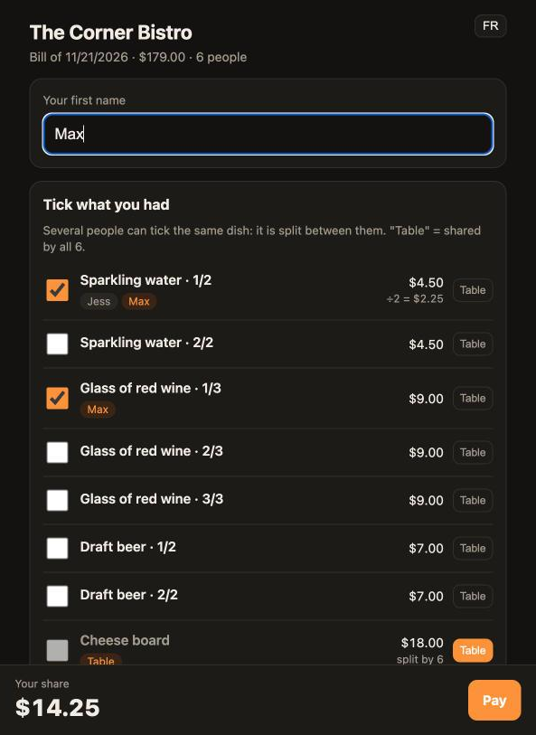

# Split the restaurant bill, from a single photo

A tiny web app to split a bill with friends.
Everyone scans a QR code, enters their first name and ticks what they had.
They instantly see what they owe, and how to pay you back.



- **Free**: it runs on Cloudflare's free plan.
- **Nothing to install for your friends**: no account, no app, just a link.
- **Shared dishes**: if two people tick the same dish, it is split between them.
- **"Table" button**: for what everyone shared (the bottle, the starter).
- **In English and French**, with a button to switch.

This comes from a **Five Minute AI** video.
This repo gives you the prompt and the code, for free.

---

## Option 1: with Claude Code (the easiest)

You need:

- **Claude Code**, with a Claude subscription (Pro or higher);
- a free **Cloudflare account** ([dash.cloudflare.com/sign-up](https://dash.cloudflare.com/sign-up));
- **Node.js** version 20 or later. If you don't have it, ask Claude Code to install it with you.

Then:

1. Take a photo of the receipt. Put it in an empty folder, named `receipt.jpg`.
2. Open a terminal in that folder and type `claude`.
3. Paste this prompt:

```text
I want to split a restaurant bill with my friends. Here is the photo of the receipt: receipt.jpg.

1. Download the template: git clone https://github.com/five-minute-ai/split-the-bill
   then copy receipt.jpg into the split-the-bill folder and work inside it.
2. Read the receipt line by line and fill in bill.json: restaurant name, date,
   each dish with its quantity and the price of ONE unit, and the receipt total.
3. Before going further, ask me: how many of us there were, my first name,
   and how people pay me back (a Venmo, PayPal or Revolut link, and/or bank details).
4. Run npm install then npm run check. If the total doesn't match,
   read the receipt again, fix it, and run it again until it's right.
5. Log me in to Cloudflare with npx wrangler login, then deploy with npm run deploy.
6. Give me the app's address and show its QR code with npm run qr -- <address>.
7. Open the app, tick a dish to test it, then untick it.
```

4. Show the QR code to your friends. Done.

---

## Option 2: by hand

1. Download this repo: green **Code** button, then **Download ZIP**. Open the folder in a terminal.
2. Open `bill.json` and replace the example with your receipt:

| Field | What to put | Example |
|---|---|---|
| `title` | the restaurant's name | `"The Corner Bistro"` |
| `date` | the date, as YYYY-MM-DD | `"2026-11-21"` |
| `people` | how many of you there were | `6` |
| `currency` | the currency, 3 letters | `"USD"` |
| `language` | the page's starting language, `en` or `fr` | `"en"` |
| `payer` | the first name of whoever paid | `"Alex"` |
| `payments` | how to pay you back: a `link` (button) or a `text` (to copy) | see the file |
| `items` | each dish: `name`, `quantity`, `price` of **one** unit | `{ "name": "Coffee", "quantity": 4, "price": 3.5 }` |
| `receipt_total` | the total printed on the receipt | `179` |

3. Install the tools: `npm install`
4. Check your file: `npm run check`. It tells you if the dishes add up to the receipt total.
5. To try it on your computer: `npm run dev`, then open <http://localhost:8787>.
6. Log in to Cloudflare: `npx wrangler login`
7. Deploy: `npm run deploy`. Your address looks like `https://split-the-bill.<your-account>.workers.dev`.
8. Show the QR code: `npm run qr -- https://split-the-bill.<your-account>.workers.dev`

---

## Build it from scratch, like in the video

In the video, there is no template. One message to Claude Code is enough, and it writes the whole app:

```text
Can you build a mini app on Cloudflare to split a restaurant bill between 7 people?
Here is the receipt: receipt.jpg. People enter their first name, tick what they had,
and see my Revolut (@your-revtag). Deploy it, then test it.
```

The app you get changes a little each time. This repo is a clean, tested version of the same idea.

---

## Bonus: control Claude Code from your phone

That's what I did at the restaurant. Claude Code was running on my computer, and I talked to it from my phone. I even sent the photo of the receipt from the table.

You need:

- a Claude subscription (Pro or higher). It doesn't work with an API key;
- the Claude app on your phone (iPhone or Android), signed in to the same account;
- your computer on, with the terminal open.

1. On the computer, open a terminal in your folder and type `claude`.
2. In Claude Code, type `/remote-control`. A QR code shows up.
3. Scan it with your phone. You can also open the Claude app, tap **Code**, then your session: it has a computer icon with a green dot.
4. You're set. You type on your phone, you can send a photo, and everything runs on your computer.

Good to know:

- If you close the terminal, the session stops. If the computer goes to sleep, it comes back by itself when it wakes up.
- Your computer opens no door to the outside: everything goes through Anthropic's servers, over an encrypted connection.
- Official docs: [code.claude.com/docs/en/remote-control](https://code.claude.com/docs/en/remote-control)

---

## How it works

- `bill.json`: your receipt. It's the only file to change.
- `src/worker.js`: the page and a small API, on a Cloudflare **Worker**.
- A **Durable Object** keeps the list of who ticked what. Writes go through one at a time: two friends ticking at once don't erase each other.
- The page updates itself every 4 seconds.
- `check.mjs`: checks the file before each deploy.

## Good to know

- Anyone with the link can tick. Only share it with your group.
- No account and no cookie: each person's first name stays on their own phone.
- New bill: change `bill.json` (the title or the date) and run `npm run deploy` again. The list starts from zero.
- To delete everything: `npx wrangler delete`.
- Cost: $0. Cloudflare's free plan allows 100,000 requests a day, far more than one dinner.

## License

MIT: you can reuse, change and share all of it.

---

Made by **Five Minute AI**.

Version française : [laminuteia/partage-addition](https://github.com/laminuteia/partage-addition)
